

---

## Who I am

  

## About

I’m drawn to systems that reward careful exploration: tracing an Active Directory attack path, building close-to-the-metal tools in Rust, and shaping game mechanics until every interaction feels deliberate. I bring that same habit of questioning assumptions into the classroom—making complex ideas easier to test, explain, and remember.

  

## Live profile

  

## Selected work

  

## Trophy case

  

  

## Recent activity

  

## Log telemetry

  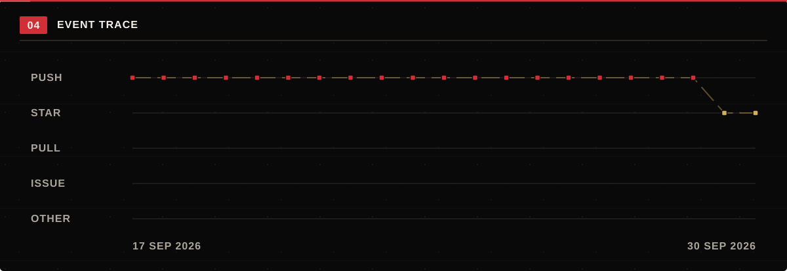

## Contributions

<!-- CONTRIBUTION_YEARS_START -->

<strong>2026</strong> · 639 contributions in the last year

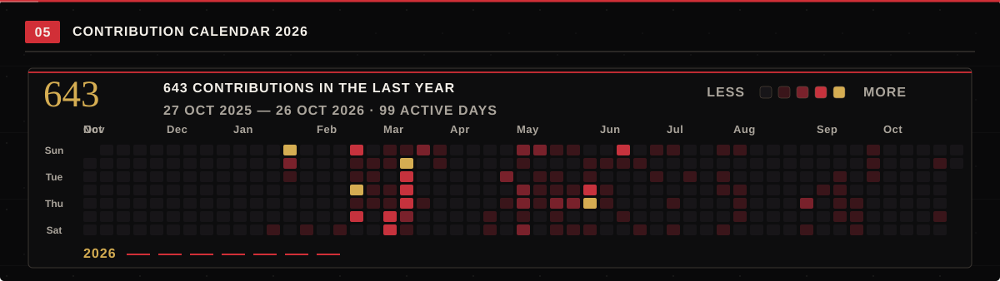

<strong>2025</strong> · 75 contributions in 2025

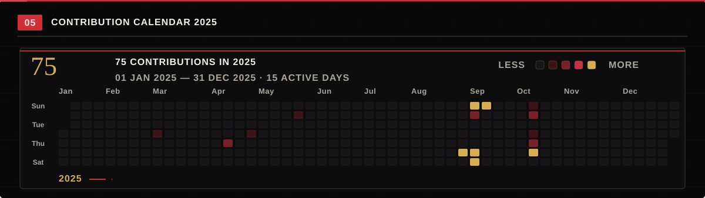

<strong>2024</strong> · 79 contributions in 2024

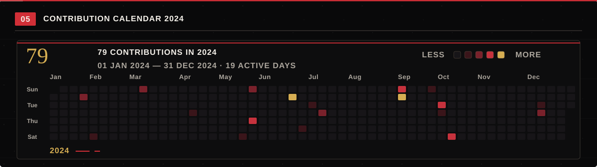

<strong>2023</strong> · 15 contributions in 2023

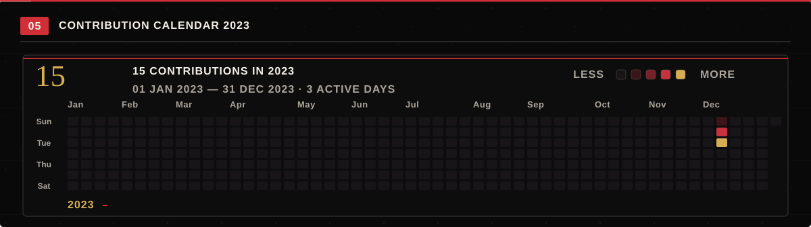

<strong>2022</strong> · 0 contributions in 2022

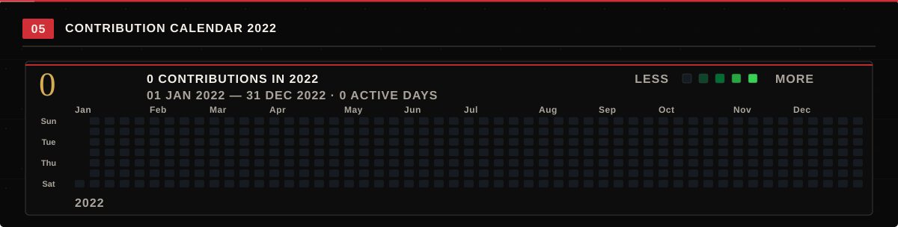

<strong>2021</strong> · 2 contributions in 2021

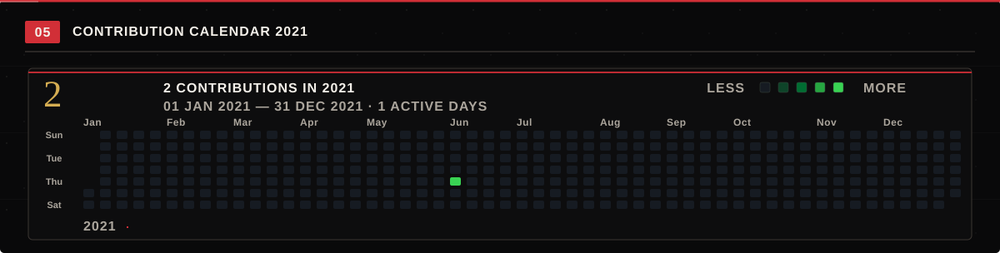

<strong>2020</strong> · 0 contributions in 2020

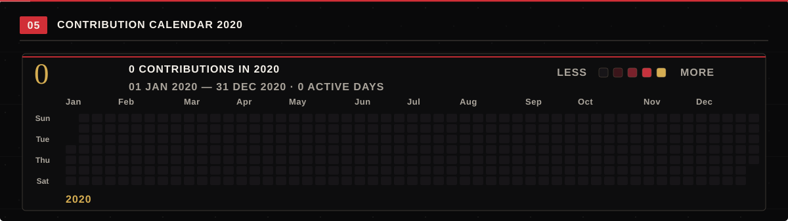

<strong>2019</strong> · 3 contributions in 2019

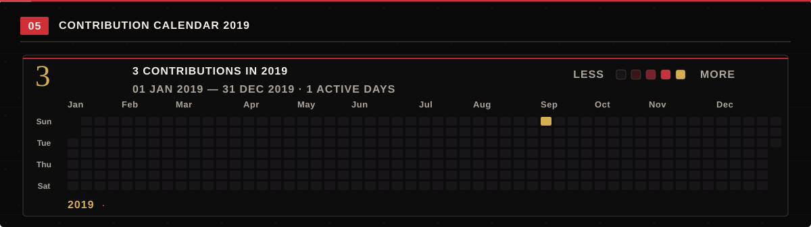

<!-- CONTRIBUTION_YEARS_END -->

## Toolkit

  

  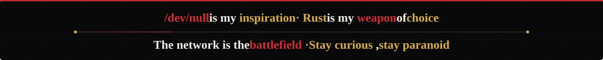

