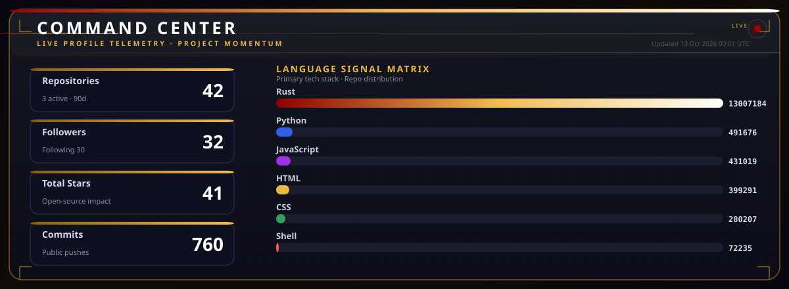
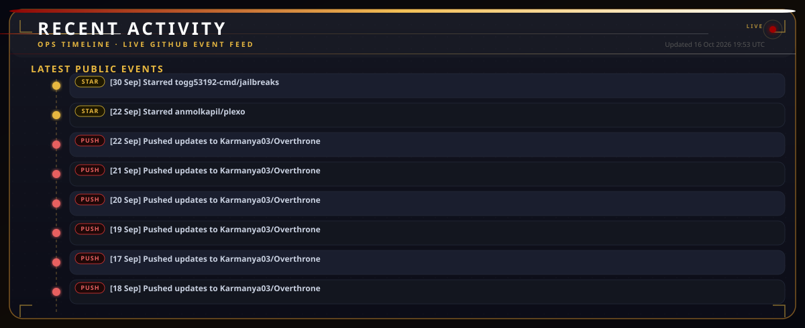

---

### 00 / Operator notes

B.E. Computer Science & Design graduate, CRTP-certified, and working as a Software Engineer. I work on offensive security and secure engineering; my side projects tend to wander into Rust, game development, and XR.

> “The quieter you become, the more you can hear.” — Kali Linux

### 01 / The workbench

Repository cards link straight to the source and show each project's language, stars, forks, and last push. Forks are left out of this index.

### 02 / Trophy cabinet

Public profile counts on a community-style rank ladder. The ranks are calculated from GitHub's API data; they are not GitHub-native achievements.

### 03 / The event log

Recent events from the public GitHub activity feed, with links back to the repositories.

### 04 / Commit telemetry

The contribution graph is a rolling view of public commits. GitHub Actions refreshes the API panels hourly; the public event feed may lag behind GitHub activity.

GitHub's own profile calendar is the source of truth for contribution counts and eligibility; it appears below this README on the profile.

### 05 / Tools on the bench

**Languages & systems**

**Cloud, services & data**

**Security, build & creative**

/dev/null is my inspiration · Rust is my weapon of choice

